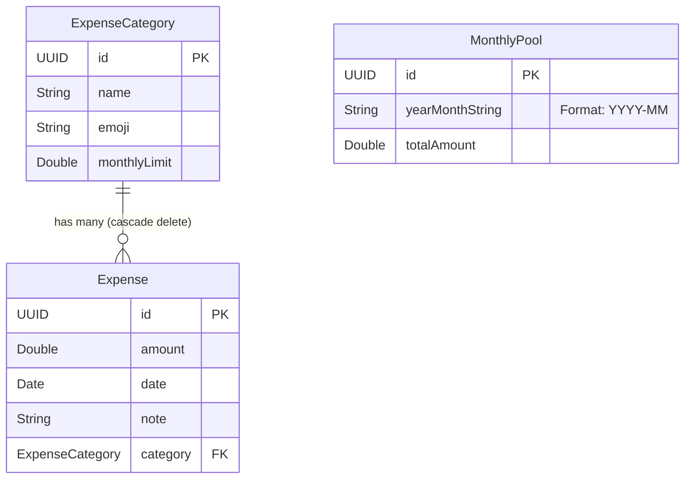

# SvHomeBudget - Project Memory & Context

> **Last Updated**: October 2026  
> **Target OS**: iOS 17.0+  
> **Frameworks**: SwiftUI, SwiftData, UniformTypeIdentifiers, XCTest

This document serves as the persistent memory and technical context for the SvHomeBudget codebase to accelerate reasoning, modifications, bug fixes, and feature additions in future conversations.

---

## 1. Architecture Overview

- **Pattern**: Declarative SwiftUI + SwiftData container injection.
- **Data Flow**:
  - `SvHomeBudgetApp` injects `.modelContainer(for: [ExpenseCategory.self, Expense.self, MonthlyPool.self])`.
  - Views consume data via `@Query` macros and `@Environment(\.modelContext)`.
  - Child views perform mutations directly via `modelContext.insert(...)`, `modelContext.delete(...)`, or property mutation on `@Model` instances (which SwiftData auto-persists).
- **Offline / Local-First**: No network dependencies, zero third-party packages. Everything is stored locally via SwiftData.
- **Backup & Portability**: Native JSON data export and import engine (`DataBackupManager`) supporting `fileExporter`, `fileImporter`, and `ShareLink`.

---

## 2. Source Code Map

| File Path | Role | Key Types / Functions |
| :--- | :--- | :--- |
| `SvHomeBudget/MyApp.swift` | App Entry Point | `struct SvHomeBudgetApp: App` Configures SwiftData container. |
| `SvHomeBudget/Models.swift` | Persistence Schema | `ExpenseCategory`, `Expense`, `MonthlyPool` `ExpenseCategory.totalSpent(for:)`, `MonthlyPool.deduct(amount:)`. |
| `SvHomeBudget/ContentView.swift` | Main Hub / Dashboard | `struct ContentView: View` Monthly cycle header stepper, pool trigger alert, progress bars, quick entry buttons, backup & restore link. |
| `SvHomeBudget/MonthlyExpensesView.swift` | Expense History | `struct MonthlyExpensesView: View` Aggregated month total, filtered line items, swipe-to-delete. |
| `SvHomeBudget/ManageCategoriesView.swift` | Category Management | `struct ManageCategoriesView: View` List categories, edit button, swipe-to-delete with cascade, add button. |
| `SvHomeBudget/CategoryFormSheet.swift` | Category Form Sheet | `struct CategoryFormSheet: View` Reusable form for Add/Edit with emoji 1-character cap and validation. |
| `SvHomeBudget/QuickAddCategoryView.swift` | Fast Entry Sheets | `struct QuickAddCategoryView: View` `struct QuickAddExpenseView: View` Quick-entry sheets triggered from ContentView. Accepts `initialDate`, contains `DatePicker`, and reduces monthly pool on expense logging. |
| `SvHomeBudget/DataBackupManager.swift` | Backup & Restore Engine | `BackupData`, `CategoryBackupDTO`, `ExpenseBackupDTO`, `MonthlyPoolBackupDTO`, `DataBackupManager`, `BackupDocument` Encodes/decodes JSON backups and applies merge or replace operations to SwiftData. |
| `SvHomeBudget/DataBackupView.swift` | Backup & Restore UI | `struct DataBackupView: View` Dashboard counts, JSON file exporter, ShareLink, file importer, merge/replace confirmation alerts. |
| `SvHomeBudgetTests/SvHomeBudgetTests.swift` | Unit Test Suite | `class SvHomeBudgetTests: XCTestCase` In-memory `ModelContainer` tests for calculations, deductions, JSON encoding, replace/merge imports, and error handling. |

---

## 3. Data Schema & Relationships

### Entity Relationship Diagram (ERD)

### Relationship Details & Rules
1. **`ExpenseCategory` -> `Expense`**:
   - Relationship definition: `@Relationship(deleteRule: .cascade, inverse: \Expense.category) var expenses: [Expense] = []`
   - When an `ExpenseCategory` is deleted, all linked `Expense` instances are deleted automatically by SwiftData.
   - When creating an `Expense`, it should be appended to `category.expenses` and inserted into `modelContext`.
2. **`MonthlyPool`**:
   - Independent model keyed by `yearMonthString` (e.g. `"2026-10"`).
   - Holds the total budgeted pool for that month.
   - Looked up in `ContentView` via `pools.first { $0.yearMonthString == currentYearMonthKey }`.
   - Mutated by `MonthlyPool.deduct(amount: Double)` whenever an expense is logged via `QuickAddExpenseView`.

---

## 4. Key Business Logic & Conventions

1. **Expense Logging & Pool Deduction**:
   - Every time an `Expense` is added in `QuickAddExpenseView`, the amount is automatically deducted from the active month's `MonthlyPool` via `reducePoolAmount(by:for:)` and `MonthlyPool.deduct(amount:)`.
   - If no pool exists for the transaction cycle month yet, a `MonthlyPool` initialized with `-amount` is inserted.
2. **Date Filtering**:
   - `ExpenseCategory.totalSpent(for: Date)` uses `Calendar.current.component(.month, from:)` and `component(.year, from:)`.
   - `MonthlyExpensesView` filters all `Expense` objects matching the `yyyy-MM` formatted string key.
3. **Currency**:
   - Currently hardcoded to EUR (`.currency(code: "EUR")` / `€`).
4. **Progress Indicators**:
   - Progress ratio: `spent / limit` capped at `1.0`.
   - Color logic:
     - `spent > limit` $\rightarrow$ `.red`
     - `ratio > 0.85` $\rightarrow$ `.orange`
     - Otherwise $\rightarrow$ `.blue`
5. **Emoji Limitation**:
   - `CategoryFormSheet` enforces `.prefix(1)` onChange of `emoji` to prevent multi-character strings.
6. **Data Export & Import Architecture**:
   - Uses `BackupData` DTO containing `[CategoryBackupDTO]`, `[ExpenseBackupDTO]`, and `[MonthlyPoolBackupDTO]` with `version: 1` and `exportDate: Date`.
   - Native `fileExporter` and `fileImporter` operate on `UTType.json`.
   - **Replace mode**: Drops all existing expenses, categories, and monthly pools, then reconstructs the data graph and rebinds expense-category relationships.
   - **Merge mode**: Matches existing categories by ID (or name fallback), updates limits and emojis, retains existing entries, inserts new expenses linked to appropriate categories, and updates/adds monthly pools.
7. **Testing Convention**:
   - Unit tests use `ModelConfiguration(isStoredInMemoryOnly: true)`.
   - `setUpWithError` initializes clean container; `tearDownWithError` nils out references.
   - Suite contains 8 comprehensive unit tests covering calculations, pool deductions, export encoding, replace/merge imports, and corrupt data handling.
8. **App Icon & Asset Catalog Configuration**:
   - The app icon is stored in `Assets.xcassets/AppIcon.appiconset`.
   - The target build setting `ASSETCATALOG_COMPILER_APPICON_NAME = AppIcon;` is configured in `project.pbxproj` under `SvHomeBudget` target build settings so Xcode's `actool` compiles the app icon into `Assets.car` and populates `CFBundleIcons` in the generated `Info.plist`.
9. **Month Navigation & Cycle Stepping**:
   - `ContentView` manages `@State private var selectedDate: Date = Date()`.
   - Steppers (`changeMonth(by:)`) navigate between past and future calendar cycles.
   - All category progress bars, monthly pools, and history navigation dynamically adapt to the currently selected month.
   - `QuickAddExpenseView` receives `initialDate: selectedDate` and features an interactive `DatePicker` to accurately log transactions to any selected cycle.

---

## 5. Guide for Future Modifications

### Adding a New Model
1. Declare the `@Model final class` in `SvHomeBudget/Models.swift`.
2. Add the class to `.modelContainer(for: [..., NewModel.self])` in `SvHomeBudget/MyApp.swift`.
3. Add the class to `ModelContainer(for: ..., configurations: config)` in `SvHomeBudgetTests/SvHomeBudgetTests.swift`.
4. Add corresponding DTO and serialization logic in `SvHomeBudget/DataBackupManager.swift`.

### Changing Currency
- Replace occurrences of `.currency(code: "EUR")` and `(€)` labels.
- Best practice for enhancement: Add a persistent user setting (e.g., `@AppStorage("preferredCurrencyCode") private var currencyCode = "EUR"`).

### Adding Charts or Visual Breakdowns
- Import `Charts` in `MonthlyExpensesView` or a new `SpendingAnalyticsView`.
- Group `filteredExpenses` by `category?.name ?? "Uncategorized"` and render a `SectorMark` (pie/donut) or `BarMark`.

### Handling Migrations
- SwiftData automatically handles lightweight schema migrations (adding optional properties or properties with default values). For complex migrations, use `VersionedSchema` and `SchemaMigrationPlan`.
